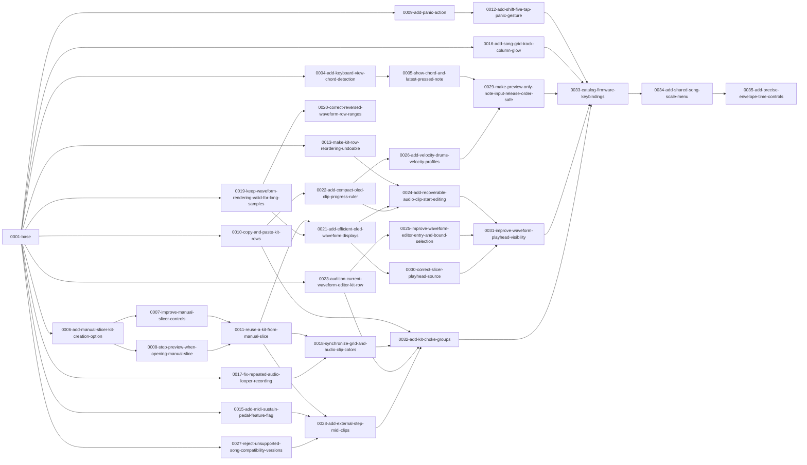

# Deluge Firmware layers

This repository defines a Git-backed layerctl composition of the Deluge Firmware fork. `layers/0001-base` imports the official upstream `main` base at a pinned commit, runs [a casing-normalization script](layers/0001-base/scripts/git_normalize_casing.pl) against Git's index before checking out files, and adds the local Nix build environment. The following layers reproduce the remaining firmware changes in order. Their commit messages use conventional subjects and explain the changes and their purpose; the original messages remain in `provenance.json`. The layer directories are ordered by their four-digit prefixes.

`provenance.json` records the original source commits, trees, authors, commit headers including JJ change IDs, messages, and remote branch tips. The empty original change at `711d48340ddb9c42d65db6088434b4b9c2ba5e58` remains in provenance but has no layer. The original branches and history remain available at the source remote. Layerctl creates new workspace commits, so those commit IDs and JJ headers differ from the originals. The original casing-fix and Nix environment layers are recorded in provenance as integrated into the base layer.

[Project plans](docs/plans/README.md) include the conversion history and current work.

[DEVIATIONS.md](DEVIATIONS.md) preserves the fork’s feature and compatibility notes outside the composed firmware source. It is copied from the original tip without edits; paths in that document refer to the firmware workspace, and its maintenance instructions describe the original source layout. The original firmware README link to that file is omitted from the composition.

## Layer graph

Arrows point from prerequisites to dependent layers. The manifests declare both feature prerequisites and dependencies needed for patches to apply. Regenerate this diagram with `layerctl graph --format mermaid` after changing dependencies.



## Rebuild

Install Perl and `layerctl` from [misc.experiments/utils/layerctl](https://github.com/NonLogicalDev/misc.experiments/tree/main/utils/layerctl), configure Git author and committer identity, and ensure SSH access to the upstream repository. Then run from this definition repository:

```sh
layerctl graph --format mermaid
layerctl projection create firmware --worktree /path/to/new-firmware-workspace
layerctl check
```

The workspace path must not already exist. The base clone prepares the casing fix before files are written, so it can run on a case-insensitive filesystem. The resulting firmware tree omits `DEVIATIONS.md` and the original README link to it; those intentional differences mean its tree ID differs from the original recorded in `provenance.json`. For the initial converted stack, compare `git -C /path/to/new-firmware-workspace rev-parse HEAD^{tree}` with `conversion.expected_initial_tree` in `provenance.json`.

For changes, create a separate projection through the relevant layer, commit the edit there, and use `layerctl layer add` or `layerctl layer refresh` from this repository. Write each layer commit message with a conventional commit subject and a body that explains what changed and why it matters. Wrap body text to a 90-character target. The [layerctl skill walkthrough](https://github.com/NonLogicalDev/misc.experiments/tree/main/utils/layerctl/skills/layerctl) covers editing, refresh, conflict recovery, and cleanup. Preserve `provenance.json` as the record of the initial conversion when later changes are made.

The included LICENSE is copied from the original firmware fork. The patches are derived from that project and retain its license and original attribution recorded in `provenance.json`.
