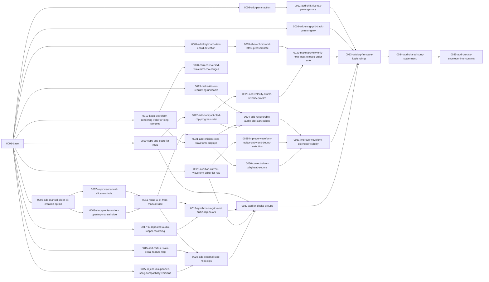

# Deluge Firmware layers

**Upstream base:** [9e3132dc](https://github.com/SynthstromAudible/DelugeFirmware/commit/9e3132dc17070695b40f69bada5565a33ce428b4) · September 13, 2026 · [1.3.0-dev](https://github.com/SynthstromAudible/DelugeFirmware/blob/9e3132dc17070695b40f69bada5565a33ce428b4/CMakeLists.txt#L6-L18) (default development version)

This repository defines a customized Deluge Community Firmware using ordered [layerctl](https://github.com/NonLogicalDev/misc.experiments/tree/main/utils/layerctl) layers. The base layer imports the pinned upstream source, normalizes Korg directory casing, and adds a local Nix build environment. Other layers add firmware features and fixes.

## Feature highlights

- [Keyboard chords](DEVIATIONS.md#3-keyboard-view-exact-chord-recognition) and [the latest held note](DEVIATIONS.md#4-keyboard-view-chord-and-latest-physical-note-display) in Keyboard View.
- [Kit creation and reuse](DEVIATIONS.md#5-kit-sample-creation-entry-and-reuse), with improved [Manual Slicer controls](DEVIATIONS.md#6-manual-slicer-positioning-and-preview-stop).
- An emergency [Panic action](DEVIATIONS.md#9-panic-action) and [copy and paste for Kit rows](DEVIATIONS.md#10-copy-paste-and-reorder-a-kit-sound-drum-row).
- [MIDI sustain pedal support](DEVIATIONS.md#11-optional-incoming-midi-sustain-pedal) and [externally stepped MIDI clips](DEVIATIONS.md#23-externally-stepped-midi-clips).
- [OLED waveform displays](DEVIATIONS.md#17-oled-sample-editing-waveform-companions), a [clip progress ruler](DEVIATIONS.md#18-oled-clip-timeline-ruler), and [recoverable Audio Clip start editing](DEVIATIONS.md#20-recoverable-audio-clip-start-editing).
- [Velocity Drums profiles](DEVIATIONS.md#22-velocity-drums-velocity-profiles), [Kit choke groups](DEVIATIONS.md#27-kit-sound-drum-choke-groups), and [fine envelope time controls](DEVIATIONS.md#30-fine-envelope-time-controls).

See [DEVIATIONS.md](DEVIATIONS.md) for the full feature and compatibility notes.

## Create a firmware workspace

Install Perl and [layerctl](https://github.com/NonLogicalDev/misc.experiments/tree/main/utils/layerctl), configure your Git author and committer identity, and ensure SSH access to GitHub. From this repository, run:

```sh
layerctl projection create firmware --worktree /path/to/new-firmware-workspace
layerctl check
```

The workspace path must not already exist. The base clone prepares the casing fix in Git before writing files, so the workspace can be created on a case-insensitive filesystem.

## Build locally

The included Nix environment targets Apple Silicon macOS. From the firmware workspace, run:

```sh
nix develop path:./.nix
DBT_NO_SYNC=1 ./dbt build Release
```

The build produces `build/Release/deluge.bin`. The workspace’s `.nix/README.md` describes the toolchain, compiler cache, and build configuration.

## Work with layers

Each directory in `layers/` contains a `layer.toml` defining its dependencies, commit message, and operations. Layerctl applies enabled layers in numbered order. Use a conventional commit subject and wrap message bodies to a 90-character target.

To make a change, create a projection through the relevant layer, commit the edit in that workspace, and use `layerctl layer add` or `layerctl layer refresh`. The [layerctl authoring walkthrough](https://github.com/NonLogicalDev/misc.experiments/tree/main/utils/layerctl/skills/layerctl) covers editing, refresh, conflict recovery, and cleanup. `provenance.json` records source commit metadata, and [project plans](docs/plans/README.md) track repository work.

## Layer graph

Arrows point from prerequisites to dependent layers. Regenerate the diagram with `layerctl graph --format mermaid` after changing dependencies.



## License

The firmware patches and included [LICENSE](LICENSE) retain their source license and attribution recorded in `provenance.json`.
