# Deluge Firmware layers

This repository defines a Git-backed layerctl composition of the Deluge Firmware fork. `layers/0001-base` imports the fork's original `main` base at a pinned commit. The following layers reproduce, in order, the file changes from each commit between that base and the original `nl/latest` tip. Their commit messages explain the changes and their purpose; the original messages remain in `provenance.json`. The layer directories are ordered by their four-digit prefixes.

`provenance.json` records the original source commits, trees, authors, commit headers including JJ change IDs, messages, and remote branch tips. The empty original change at `711d48340ddb9c42d65db6088434b4b9c2ba5e58` is retained as a no-op marker with a descriptive layer commit message; its original message was empty. The original branches and history remain available at the source remote. Layerctl creates new workspace commits, so those commit IDs and JJ headers differ from the originals.

## Layer graph

Arrows point from prerequisites to dependent layers. The manifests declare both feature prerequisites and dependencies needed for the patches to apply; shared changes to `DEVIATIONS.md` account for some of the latter. Regenerate this diagram with `layerctl graph --format mermaid` after changing dependencies.

```mermaid
flowchart LR
  n0["0001-base"]
  n1["0002-consolidate-korg-directory-casing"]
  n2["0003-add-local-nix-build-environment"]
  n3["0004-add-keyboard-view-chord-detection"]
  n4["0005-show-chord-and-latest-pressed-note"]
  n5["0006-add-manual-slicer-kit-creation-option"]
  n6["0007-improve-manual-slicer-controls"]
  n7["0008-stop-preview-when-opening-manual-slice"]
  n8["0009-add-panic-action"]
  n9["0010-copy-and-paste-kit-rows"]
  n10["0011-reuse-a-kit-from-manual-slice"]
  n11["0012-add-shift-five-tap-panic-gesture"]
  n12["0013-make-kit-row-reordering-undoable"]
  n13["0014-empty-change-marker"]
  n14["0015-add-midi-sustain-pedal-feature-flag"]
  n15["0016-add-song-grid-track-column-glow"]
  n16["0017-fix-repeated-audio-looper-recording"]
  n17["0018-synchronize-grid-and-audio-clip-colors"]
  n18["0019-keep-waveform-rendering-valid-for-long-samples"]
  n19["0020-correct-reversed-waveform-row-ranges"]
  n20["0021-add-efficient-oled-waveform-displays"]
  n21["0022-add-compact-oled-clip-progress-ruler"]
  n22["0023-audition-current-waveform-editor-kit-row"]
  n23["0024-add-recoverable-audio-clip-start-editing"]
  n24["0025-improve-waveform-editor-entry-and-bound-selection"]
  n25["0026-add-velocity-drums-velocity-profiles"]
  n26["0027-reject-unsupported-song-compatibility-versions"]
  n27["0028-add-external-step-midi-clips"]
  n28["0029-make-preview-only-note-input-release-order-safe"]
  n29["0030-correct-slicer-playhead-source"]
  n30["0031-improve-waveform-playhead-visibility"]
  n31["0032-add-kit-choke-groups"]
  n32["0033-catalog-firmware-keybindings"]
  n33["0034-add-shared-song-scale-menu"]
  n34["0035-add-precise-envelope-time-controls"]
  n0 --> n1
  n0 --> n2
  n0 --> n3
  n3 --> n4
  n4 --> n5
  n5 --> n6
  n6 --> n7
  n7 --> n8
  n8 --> n9
  n7 --> n10
  n8 --> n11
  n9 --> n12
  n10 --> n12
  n0 --> n13
  n12 --> n14
  n14 --> n15
  n15 --> n16
  n16 --> n17
  n0 --> n18
  n18 --> n19
  n17 --> n20
  n18 --> n20
  n20 --> n21
  n21 --> n22
  n21 --> n23
  n22 --> n24
  n24 --> n25
  n0 --> n26
  n25 --> n27
  n26 --> n27
  n27 --> n28
  n20 --> n29
  n23 --> n30
  n28 --> n30
  n29 --> n30
  n30 --> n31
  n31 --> n32
  n11 --> n33
  n32 --> n33
  n33 --> n34
```



## Rebuild

Install `layerctl` from [misc.experiments/utils/layerctl](https://github.com/NonLogicalDev/misc.experiments/tree/main/utils/layerctl), configure Git author and committer identity, and ensure SSH access to the source fork. Then run from this definition repository:

```sh
layerctl graph --format mermaid
layerctl projection create firmware --worktree /path/to/new-firmware-workspace
layerctl check
```

The workspace path must not already exist. The pinned base contains paths that differ only by letter case. The projection workspace and temporary directory must both be on a case-sensitive filesystem; set `TMPDIR` accordingly when necessary. To confirm the original reconstructed tree, compare `git -C /path/to/new-firmware-workspace rev-parse HEAD^{tree}` with the final `original_tree` in `provenance.json`.

For changes, create a separate projection through the relevant layer, commit the edit there, and use `layerctl layer add` or `layerctl layer refresh` from this repository. Write each layer commit message with a subject and body that explain what changed and why it matters. The [layerctl skill walkthrough](https://github.com/NonLogicalDev/misc.experiments/tree/main/utils/layerctl/skills/layerctl) covers editing, refresh, conflict recovery, and cleanup. Preserve `provenance.json` as the record of the initial conversion when later changes are made.

The included LICENSE is copied from the original firmware fork. The patches are derived from that project and retain its license and original attribution recorded in `provenance.json`.
